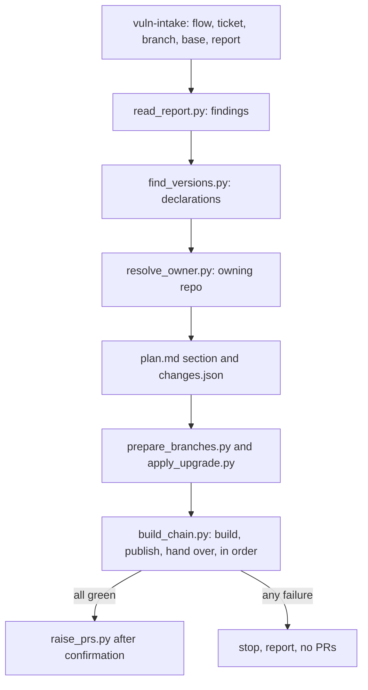

# Spec Kit Extension Spec Addendum: Engineering Vulnerability Upgrade

Addendum to *Skill-Driven Clarify, Plan and Test Phases* (the parent spec, `spec-kit-extension-spec.md`). It adds one more stage-to-skill pairing to the `sdlc-skills` extension using the binding model in the parent's section 9, plus Python scripts that do the deterministic work: reading a scanner report, finding versions across repos, editing them, building the repos in order with their own build tool, and raising pull requests.

**Implementation status.** Built in `speckit-extensions/sdlc-skills/` (scripts in `scripts/vuln/`, config in `config/vuln-flows.json`, tests in `tests/test_vuln_scripts.py`) with its skill in `skills/engineering-vulnerability-upgrade/`. Where this spec and the code differ, the code wins. Requirement IDs are prefixed `GV-`.

## 1. Overview and goals

**Problem.** A vulnerability scanner reports dependencies at vulnerable versions together with fixed versions. In a product made of several repositories that depend on each other, fixing one means finding where each version is declared (build files, property files, version catalogs, shared version lists), deciding which repo owns the change, building every affected repo in dependency order against the freshly built upstreams, and raising one pull request per changed repo. Done by hand, this is slow and easy to get wrong.

**Goals**

- G1: Read the vulnerable and fixed versions from a scanner report file.
- G2: Find every place each vulnerable version is declared and change it in the repo that owns it.
- G3: Build and publish the affected repos in dependency order with their own build tool (Gradle, Maven, or any configured command), each against the versions the earlier repos just produced.
- G4: Raise pull requests only when every build passes and the user confirms.
- G5: Record what was found, changed and built, so a reviewer can audit it.

**Non-goals**

- Choosing fixed versions. They come from the report; the tool never invents or "improves" a version.
- Fixing vulnerabilities in application code or operating-system packages in container images.
- Running tests; the project's CI runs them on the pull requests.
- Merging pull requests, releasing or deploying.

**Scope at a glance**

| Spec Kit step | What runs | Runs when |
| --- | --- | --- |
| Entry command | `speckit.sdlc-skills.vuln-intake`: asks flow, ticket reference, branch, base branch and report file; reads the report; seeds `spec.md` | The user starts a vulnerability fix |
| `plan` | Locate pass: finds declarations and the owning repo per dependency | Detector `vuln_report` returns yes |
| `tasks` | One `[VULN]` task per changed repo in flow order, plus one `build_chain.py` task | Same |
| `implement.vuln-upgrade` | Creates branches, applies edits, builds and publishes in order | `[VULN]` task |
| `after_implement` hook | `speckit.sdlc-skills.vuln-pr`: raises PRs if every build passed | Feature has `vuln/intake.json` |

## 2. Findings that shape the design

1. The steps are mostly deterministic (parse a report, search files, edit lines, run builds, git, PRs). They belong in scripts; the model asks questions, reads results and resolves ambiguous cases. Every script writes JSON so each step is checkable.
2. Questions to the user cannot be asked by an unattended script, so a command asks and passes the answers to scripts as arguments.
3. Repo chains, build tools and the files that pin upstream versions differ per product, so they are configuration (`vuln-flows.json`), not code.
4. Later repos consume versions produced by earlier ones. A downstream build only proves the fix if it resolves the upstream that was just built, so each published version is handed to the later repos before they build.
5. Raising PRs is outward-facing, so it is a separate, confirmed step that only happens after all builds pass.
6. Agents tend to run the build tool directly. Only the chain script performs the version hand-over and the restore, so building outside it must be forbidden in the skill and detected by the script.

## 3. Requirements

| ID | Requirement |
| --- | --- |
| GV-1 | `speckit.sdlc-skills.vuln-intake` asks, in order: flow, ticket reference, working branch, base branch, report file(s). The base branch is always asked and suggested from the branch name when it carries a version line |
| GV-2 | `read_report.py` reads local report files only (Trivy JSON, or a text/HTML table, or free-text lines as a fallback) and writes normalized findings: dependency, ecosystem, vulnerable version, fixed version, fix candidates, advisories, severity, images, status |
| GV-3 | Rows for one package and version are merged across images and advisories; with several fix versions the highest is chosen and the others kept as candidates |
| GV-4 | Findings that cannot be read with confidence (unknown ecosystem, no fix version) are `needs-confirmation` and are not searched until the user resolves them. Operating-system packages are `out-of-scope` |
| GV-5 | `find_versions.py` searches the configured `version_files` in every repo of the flow and reports file, line and match type: literal declarations (Gradle coordinates, Maven `<dependency>` blocks, any line naming the artifact and version), property definitions that a declaration references (`$x`, `${x}`, version-catalog `version.ref`, Maven `${x.version}`), and property candidates |
| GV-6 | `resolve_owner.py` decides per dependency: change in the platform repo (configured, or the first repo of the flow), in a downstream repo that declares or overrides it, or both; `review` for candidates; `not-affected`; `not-found` |
| GV-7 | Property indirection is followed: the definition is edited, never the reference |
| GV-8 | `apply_upgrade.py` edits only the lines in `changes.json`, preserves each file's bytes and line endings, refuses a line that no longer holds the expected old version, and refuses a repo that is not on the working branch or is dirty |
| GV-9 | Plan output is a Vulnerability Upgrade section in `plan.md` plus `specs/<feature>/vuln/changes.json` |
| GV-10 | `prepare_branches.py` checks out the working branch where it exists and creates it from the base branch (per repo when overridden) where it does not; check-only mode reports without changing anything |
| GV-11 | Flows are configured under `flows` in `vuln-flows.json` as ordered repo lists; repos sit side by side under `workspace_root`, or under the folder above the project the extension runs in |
| GV-12 | `build_chain.py` builds strictly one repo at a time in flow order, never in parallel; the first failure stops the chain and records the repo, step and log tail |
| GV-13 | By default only repos that can be affected are built (`--changed-only`): changed repos plus every repo that pins one of them, followed transitively through the `handoff` rules; the others are listed as skipped |
| GV-14 | Build tool presets: `gradle` (`./gradlew clean build -x test`, `publishToMavenLocal`, version from `properties`) and `maven` (`./mvnw clean install -DskipTests`, version from `help:evaluate`). The repo's wrapper is used when present, else the tool on the PATH. Any tool works through explicit `command`, `publish_command`, `version_command` and `version_pattern`; any key can be overridden per repo, including `env` |
| GV-15 | Builds are always clean and never run tests |
| GV-16 | Version hand-over: after a repo is published, its version is read from its build tool and written into the configured keys of the later repos' files (`key=value`, `key: value`, `key = "value"`, or Maven `<key>value</key>`). Only existing keys change; an unreadable version is reported and never guessed |
| GV-17 | Every hand-over edit is temporary: original bytes are kept in `vuln/handoff-backup.json` and restored when the chain ends, even after a failure; a later run restores files left by a stopped run first |
| GV-18 | The chain refuses to start when a hand-over key already differs from its committed value, naming the file |
| GV-19 | `--from-repo` resumes at a repo; the repos before it are assumed published and their versions are handed over again |
| GV-20 | Each build's output is written to its log while it runs, with a heartbeat line every minute |
| GV-21 | `raise_prs.py` runs only if every build passed. It shows the plan without `--yes`; with `--yes` it commits only the planned files, pushes one branch per changed repo, and opens one PR per repo against the base branch, listing the changes, sibling PRs and the source of any finding that did not come from the report. Existing branches and PRs are reused; nothing is merged |
| GV-22 | A build failure always stops the chain and blocks PRs, regardless of `required` |
| GV-23 | All scripts are Python standard library only, run on Linux, macOS and Windows, use `subprocess` without a shell, accept `--dry-run` where they change things, and mask secret-looking environment values in output |
| GV-24 | Idempotent: re-running updates the plan section and reuses existing branches and PRs |
| GV-25 | The installer's `update` keeps a project's own flows, hand-over rules, build settings and overrides; the shipped `vuln-flows.json` holds only a generic example |

## 4. Architecture

No new architecture. The preset's wraps call `speckit.sdlc-skills.run <stage>` as in the parent spec; the vulnerability bindings route to the adapter, which calls these scripts:

```text
scripts/vuln/
├── common.py            shared helpers, workspace lookup, secret masking
├── intake.py            records flow, ticket, branch, base branch
├── read_report.py       scanner report -> findings.json
├── find_versions.py     declarations per repo -> hits.json
├── resolve_owner.py     owning repo per dependency -> changes.json
├── prepare_branches.py  check out or create the working branch
├── apply_upgrade.py     edit the planned lines
├── build_chain.py       build, publish and hand over in order
└── raise_prs.py         push and open PRs after confirmation
```



## 5. Configuration

```json
{
  "workspace_root": "~/work",
  "branch_prefix": "vuln/",
  "platform_repo": "",
  "reference_paths": [],
  "version_files": ["pom.xml", "*.gradle", "*.gradle.kts", "gradle.properties", "*.properties", "*.toml", "*.conf"],
  "build": { "tool": "gradle", "timeout_seconds": 3600 },
  "repo_overrides": { "service-b": { "tool": "maven" } },
  "handoff": [
    { "from": "platform", "version_source": "build",
      "to": [ { "repo": "service-a", "file": "gradle.properties", "key": "platformVersion" },
              { "repo": "service-b", "file": "pom.xml", "key": "platform.version" } ] }
  ],
  "flows": { "main": { "publish": true, "repos": ["platform", "service-a", "service-b"] } }
}
```

The committed pins in each repo stay at released versions; the hand-over only rewires them for the local build. Moving committed pins to new releases is the project's own release process.

## 6. Registry entries

```yaml
bindings:
  - id: plan-vuln-upgrade
    stage: plan
    order: 30
    skill: engineering-vulnerability-upgrade
    trigger: { type: detect, detector: vuln_report, ask_if_unknown: true }
  - id: tasks-vuln-upgrade
    stage: tasks
    skill: engineering-vulnerability-upgrade
    trigger: { type: detect, detector: vuln_report }
  - id: impl-vuln-upgrade
    stage: implement.vuln-upgrade
    skill: engineering-vulnerability-upgrade
    trigger:
      type: any
      of:
        - { type: task_tag, tag: VULN }
        - { type: path_glob, globs: ["**/pom.xml", "**/*.gradle", "**/*.gradle.kts", "**/gradle.properties", "**/*.versions.toml"] }
    settings: { confirm_before_pr: true, fail_on_build_error: true }
```

`extension.yml` adds the commands `speckit.sdlc-skills.vuln-intake` and `speckit.sdlc-skills.vuln-pr`, and an `after_implement` hook for `vuln-pr` that does nothing when the feature has no `vuln/intake.json`.

## 7. Governance and security

- The skill is pinned in `skills.lock.yml` like the other vendored skills (parent section 11).
- Reports are read from local files; no credentials are needed or stored. Secret-looking environment values are masked in script output.
- Edits are restricted to lines found by the locate step; a line that changed since is refused.
- PRs are never merged by the tool, and PR creation needs the user's confirmation.
- The plan section, `changes.json`, build results and `skill-runs.md` are the audit trail (NFR-1).

## 8. Acceptance criteria

| ID | Scenario | Covers |
| --- | --- | --- |
| AC-G1 | Given the intake command, it asks flow, ticket reference, branch, base branch and report file in that order, and writes `intake.json` | GV-1 |
| AC-G2 | Given a Trivy JSON report with a library and an OS package, the library is `ok` and the OS package `out-of-scope` | GV-2, GV-4 |
| AC-G3 | Given a table report listing one package under two images with two fix versions, one finding is produced with both images and the higher fix | GV-3 |
| AC-G4 | Given a Gradle literal, a Gradle property, a version-catalog entry, a Maven dependency block and a Maven property, each is found with the right match type | GV-5, GV-7 |
| AC-G5 | Given a version only in the platform repo, the change is planned there only | GV-6 |
| AC-G6 | Given the apply step, only lines in `changes.json` change and CRLF files keep CRLF | GV-8 |
| AC-G7 | Given a flow, repos build in exactly the configured order; the first failure stops the chain and blocks PRs | GV-12, GV-22 |
| AC-G8 | Given a change only in a downstream repo and `--changed-only`, unchanged upstreams are skipped and listed | GV-13 |
| AC-G9 | Given `tool: maven` for one repo, that repo uses the Maven commands and the others the default | GV-14 |
| AC-G10 | Given a published version, later repos' keys are rewritten for their builds (properties and Maven XML) and restored exactly afterwards | GV-16, GV-17 |
| AC-G11 | Given a stopped run, the next run restores the files it left edited | GV-17 |
| AC-G12 | Given a hand-edited pin, the chain refuses to start and names the file | GV-18 |
| AC-G13 | Given `--from-repo`, earlier hand-overs are applied again without rebuilding | GV-19 |
| AC-G14 | Given all builds green, the PR plan names each repo, branch and base branch, and nothing is pushed without `--yes` | GV-21 |
| AC-G15 | Given an installer update, the project's flows and hand-over rules are kept | GV-25 |

Tests use temporary git repos, stub build commands and sample reports, so no network or real builds are needed. Assertions are on artifacts (files, JSON, exit codes), never on model wording.

## 9. Risks and open questions

| Risk | Mitigation |
| --- | --- |
| Report misparsed | Every finding needs both versions; the user confirms the table before any edit |
| Version declared in an unexpected place | Configurable `version_files`; `not-found` is reported, never skipped silently |
| Wrong owner chosen | Evidence (file, line) is shown and the user confirms the plan |
| Long builds | Changed-only selection, live logs and heartbeat, resume with `--from-repo` |
| Local environment differences (JDK, line endings, unreachable services) | Per-repo `env` and command overrides; failures are reported with the log tail, never worked around silently |

**Open questions**

- GQ1: Should the tool clone missing repos? It does not today.
- GQ2: Should other ecosystems (npm, pip) get build presets, or stay on explicit commands?
