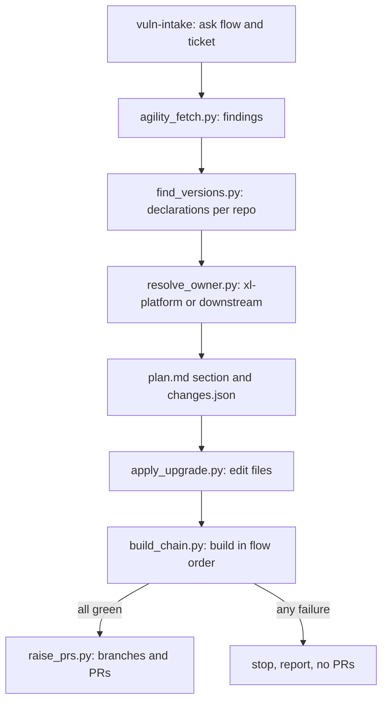

# Spec Kit Extension Spec Addendum: Engineering Vulnerability Upgrade from an Agility Ticket

Addendum to *Skill-Driven Clarify, Plan and Test Phases* (the parent spec, `spec-kit-extension-spec.md`). It adds one more stage-to-skill pairing to the `sdlc-skills` extension using the binding model in the parent's section 9, plus a set of Python scripts that do the deterministic work: reading the Agility ticket, finding versions across repos, building in order, and raising pull requests.

This replaces the generic draft `vulnerability-upgrade-spec.md` in the same folder.

**Implementation status.** Built as a standalone extension in `speckit-extensions/engineering-vulnerability-upgrade/` (scripts, commands, config, tests) with its skill in `skills/engineering-vulnerability-upgrade/`, following the layout of the engineering-plan pair. Where this spec and the code differ, the code wins: the flow config is `config/vuln-flows.json` (standard library only, no YAML), the branch is asked first and created from a parent branch when missing (`prepare_branches.py`), both flows publish to Maven Local, and operating-system packages in the report are listed as out of scope. Section numbers below refer to the parent spec. IDs are prefixed `GV-`.

## 1. Overview and goals

**Problem.** Vulnerability tickets in Agility list vulnerable dependency versions and their fixed versions. Fixing one means finding where each version is declared across many Gradle repos (`dependencies.conf`, `build.gradle`, property files), deciding whether the fix belongs in `xl-platform` or in a downstream repo that overrides it, building the whole chain in order, and raising PRs. Today this is manual and easy to get wrong.

**Goals**

- G1: Take a product flow (deploy or release) and an Agility ticket number, and read the vulnerable and fixed versions from the ticket.
- G2: Find every place each vulnerable version is declared and change it in the right repo (platform if it lives only there, otherwise the downstream repo that holds or overrides it).
- G3: Build the full repo chain for the chosen flow in dependency order, publishing where the next step needs the result.
- G4: Raise PRs only when every build passes.
- G5: Record what was found, changed and built, so a reviewer can audit it.

**Non-goals**

- Choosing fixed versions. They come from the ticket; the tool never invents or "improves" a version.
- Fixing vulnerabilities in application code, or non-Gradle ecosystems.
- Merging PRs, releasing, or deploying.
- Replacing human review of the PRs.

**Scope at a glance**

| Spec Kit step | What runs | Runs when |
| --- | --- | --- |
| Entry command | `speckit.sdlc-skills.vuln-intake`: asks flow and ticket, fetches the ticket, seeds `spec.md` | User starts a vulnerability fix |
| `plan` | `engineering-vulnerability-upgrade` locate pass: finds declarations and the owning repo per dependency | Detector `agility_vuln_ticket` returns yes |
| `tasks` | Emits one `[VULN]` task per repo in flow order | Plan has a Vulnerability Upgrade section |
| `implement.vuln-upgrade` | Applies edits, builds and publishes in order | `[VULN]` task |
| `after_implement` hook | `speckit.sdlc-skills.vuln-pr`: raises PRs if all builds are green | Always for this flow |

## 2. Findings that shape the design

1. The steps are mostly deterministic (HTTP call, file search, ordered builds, git, PRs). They belong in scripts, not in model judgment. The model's job is limited to interpreting free-text ticket content and resolving ambiguous override cases; every script writes JSON so the model's step is checkable.
2. Questions to the user (flow, ticket number) cannot be asked by a script that runs unattended, so a command asks and passes the answers to scripts as arguments.
3. The two flows have different repo chains and different publish needs, so each flow is a config entry (`flows:`), not code.
4. Build order matters because later repos consume versions produced by earlier ones, so the runner stops at the first failed build and never raises PRs after a failure.
5. Raising PRs is outward-facing, so it is a separate gated step and only happens after all builds pass.

## 3. Requirements

| ID | Requirement |
| --- | --- |
| GV-1 | Entry command `speckit.sdlc-skills.vuln-intake` asks the user to choose the flow: `deploy` or `release`, then asks for the Agility ticket number; both can also be passed as arguments for non-interactive runs |
| GV-2 | `agility_fetch.py` reads the ticket through the Agility REST API and returns a normalized JSON list of findings: dependency (group:artifact where given), vulnerable version, fixed version, advisory ID if present |
| GV-3 | The Agility token comes from an environment variable (`AGILITY_TOKEN`) or the OS credential store; it is never written to a file, log or artifact |
| GV-4 | Findings that cannot be parsed with confidence (missing fixed version, ambiguous name) are flagged `needs-confirmation` and the user is asked once before planning continues |
| GV-5 | `find_versions.py` searches `dependencies.conf`, `build.gradle`, `*.gradle`, `gradle.properties` and other `*.properties` files in each repo of the flow for each vulnerable dependency and version, and reports file, line, key and match type (literal, property reference, catalog entry) |
| GV-6 | `resolve_owner.py` checks `xl-reference` in `xl-platform` first. Rule: if the version is declared only in `xl-platform`, the change goes in `xl-platform`; if a downstream repo declares or overrides it, the change goes in that repo's conf and gradle files; if both hold it, change both and report it |
| GV-7 | Property indirection is followed: if a file references a property (for example `${someVersion}`), the edit targets the property's definition, not the reference |
| GV-8 | `apply_upgrade.py` edits only the identified lines, changing the vulnerable version to the ticket's fixed version; it never touches unrelated versions and prints a unified diff per repo |
| GV-9 | Plan output is a Vulnerability Upgrade section in `plan.md` plus `specs/<feature>/vuln/changes.json` listing each dependency, owning repo, file, line, old and new version |
| GV-10 | `build_chain.py` builds the repos of the chosen flow in the configured order. A failure stops the chain and records the repo, the command and the log tail |
| GV-11 | Deploy flow chain, in order: `xl-platform`, `central-configuration`, `deploy-central-configuration`, `deploy-permission-service`, `xld-stitch-core`, `deploy-task-engine`, `xl-deploy`, `xl-satellite`, `overthere`, `deploy-cli` |
| GV-12 | Release flow chain, in order: `xl-platform`, `xl-release`; each repo is built and then pushed (published) to pTML, because the next step uses those versions |
| GV-13 | Repos not changed by the upgrade are still built when they are in the chain, using the versions published or built earlier in the same run |
| GV-14 | `raise_prs.py` runs only if every build in the chain passed. It pushes one branch per changed repo (`vuln/<ticket>`) and opens one PR per repo, each linking the Agility ticket and the other PRs |
| GV-15 | If any build fails, no branch is pushed and no PR is created; the report names the failure and the working-tree state is left in place for inspection |
| GV-16 | Fail soft (FR-9, NFR-5) applies to detection and discovery warnings, but build failures always stop the chain and block PRs regardless of `required` |
| GV-17 | All scripts are Python standard library only, run on Linux, macOS and Windows, use `pathlib` and `subprocess` without a shell, accept `--dry-run`, and print JSON with `--json` |
| GV-18 | Idempotent (NFR-2): re-running updates the plan section, reuses an existing `vuln/<ticket>` branch and PR instead of creating duplicates |
| GV-19 | Every run writes an audit record: ticket, flow, findings, changes, build results, PR URLs, tool and script versions |

## 4. Architecture

No new architecture. The preset's wraps call `speckit.sdlc-skills.run <stage>` as in the parent spec; the new bindings route to the scripts below.

```text
extension/
├── commands/
│   ├── speckit.sdlc-skills.vuln-intake.md   # asks flow and ticket, calls agility_fetch
│   └── speckit.sdlc-skills.vuln-pr.md       # gate and PR step
├── adapters/engineering-vulnerability-upgrade.md
├── detectors/agility_vuln_ticket.md
├── skills/engineering-vulnerability-upgrade/              # SKILL.md: how to interpret ticket text and override cases
├── config/vuln-flows.yml                    # flows, repo order, build and publish commands
└── scripts/vuln/
    ├── agility_fetch.py
    ├── find_versions.py
    ├── resolve_owner.py
    ├── apply_upgrade.py
    ├── build_chain.py
    └── raise_prs.py
```



## 5. Intake: flow and ticket

The command asks two questions, in order, and writes `specs/<feature>/vuln/intake.json`.

1. **Flow.** Product, deploy or release. Each has a different build flow (GV-11, GV-12).
2. **Agility ticket number** (for example `D-12345` or `S-12345`).

`agility_fetch.py` then reads the ticket (title, description, custom fields, attachments' text where the API exposes it) and returns findings. Where the ticket text is free-form, the skill interprets it and the script validates the result: every finding must have a vulnerable version and a fixed version, otherwise it is `needs-confirmation` (GV-4). The command shows the findings table and asks for confirmation before any file is touched.

`intake` also seeds `spec.md` with a short problem statement, the ticket link and the findings table, so `clarify`, `plan`, `tasks` and `implement` run on a real spec.

## 6. Locating the right place to change

For each finding, in each repo of the chosen flow:

1. `find_versions.py` searches the version files listed in GV-5 for the dependency and the vulnerable version, including property indirection (GV-7).
2. `resolve_owner.py` applies the rule in GV-6:

| Situation | Where the change goes |
| --- | --- |
| Version found only in `xl-reference` / `xl-platform` | `xl-platform` |
| Version also declared in a downstream repo conf or gradle file (override) | That downstream repo; also `xl-platform` if it holds the vulnerable version too |
| Downstream repo pins a different, non-vulnerable version | No change; recorded as `not-affected` |
| Not found anywhere in the flow | Recorded as `not-found` with a warning; the ticket may target a transitive-only dependency (see open question GQ3) |

The result for each dependency is a row in `plan.md` (dependency, vulnerable version, fixed version, owning repo, file and line, decision) and an entry in `changes.json`. Re-running updates rows in place (GV-18).

## 7. Applying changes and building

**Apply.** `apply_upgrade.py` edits the lines in `changes.json` on a branch `vuln/<ticket>` in each affected repo (GV-8). One diff per repo is shown in the report.

**Build.** `build_chain.py` reads `vuln-flows.yml` and builds in order.

```yaml
schema_version: "1.0"
workspace_root: "~/work"               # where repos are cloned or found
branch_prefix: "vuln/"
flows:
  deploy:
    publish: false                      # see open question GQ2
    repos:
      - xl-platform
      - central-configuration
      - deploy-central-configuration
      - deploy-permission-service
      - xld-stitch-core
      - deploy-task-engine
      - xl-deploy
      - xl-satellite
      - overthere
      - deploy-cli
  release:
    publish: true                       # build and push to pTML, next step uses these versions
    repos:
      - xl-platform
      - xl-release
build:
  command: "./gradlew build"            # per-repo overrides allowed
  publish_command: "./gradlew publish"  # confirm against the real pTML target (GQ1)
  version_handoff: "property"           # how a published version reaches the next repo (GQ4)
```

Rules:

- Repos are built strictly in the listed order; the first failure stops the chain (GV-10).
- In the release flow, each repo is published right after its build passes, so the next repo resolves the new version (GV-12).
- Output of each step is captured to `specs/<feature>/vuln/build-<repo>.log`; the report shows the status and the tail of any failing log.

## 8. Raising PRs

`raise_prs.py` runs from the `after_implement` hook `speckit.sdlc-skills.vuln-pr` and only when `build_chain.py` reports all green (GV-14, GV-15).

- One branch and one PR per changed repo, titled `fix(deps): <short summary> [<ticket>]` following Conventional Commits.
- The PR body lists the findings the repo closes, old and new versions, the build results for the whole chain, and links to the sibling PRs and the Agility ticket.
- With `confirm_before_pr: true` (default) the command shows the PR list and asks before pushing, because pushing and opening PRs is outward-facing. Set it to `false` to run unattended.
- Existing branches and PRs are reused (GV-18).

## 9. Registry entries

```yaml
bindings:
  - id: plan-vuln-upgrade
    stage: plan
    order: 30
    skill: engineering-vulnerability-upgrade
    trigger: { type: detect, detector: agility_vuln_ticket, ask_if_unknown: true }
  - id: tasks-vuln-upgrade
    stage: tasks
    skill: engineering-vulnerability-upgrade
    trigger: { type: detect, detector: agility_vuln_ticket }
  - id: impl-vuln-upgrade
    stage: implement.vuln-upgrade
    skill: engineering-vulnerability-upgrade
    trigger:
      type: any
      of:
        - { type: task_tag, tag: VULN }
        - { type: path_glob, globs: ["**/dependencies.conf", "**/gradle.properties", "**/build.gradle"] }
    settings: { confirm_before_pr: true, fail_on_build_error: true }
```

`extension.yml` additions: the two commands above and an `after_implement` hook for `speckit.sdlc-skills.vuln-pr` with `optional: false`. The detector `agility_vuln_ticket` returns `yes` when `intake.json` exists or `spec.md` references an Agility vulnerability ticket.

## 10. Governance and security

- Skills and scripts are reviewed like code (parent section 11). The new skill is pinned in `skills.lock.yml`.
- The Agility token is read from the environment only (GV-3); scripts redact it from logs.
- Edits are restricted to files matched by the discovery step; `apply_upgrade.py` refuses to change a line that does not still contain the expected old version.
- PRs are never merged by the tool, and PR creation is gated by `confirm_before_pr`.
- The audit record (GV-19) and the plan section are the audit trail (NFR-1).

## 11. Acceptance criteria

| ID | Scenario | Covers |
| --- | --- | --- |
| AC-G1 | Given the intake command with no arguments, then it asks flow first and ticket second, and writes `intake.json` | GV-1 |
| AC-G2 | Given a ticket fixture listing three dependencies with vulnerable and fixed versions, when `agility_fetch.py` runs, then it returns three normalized findings | GV-2 |
| AC-G3 | Given a ticket line with no fixed version, then the finding is `needs-confirmation` and the user is asked once | GV-4 |
| AC-G4 | Given the token environment variable is unset, then the script fails with a clear message and prints no token | GV-3 |
| AC-G5 | Given a version declared only in `xl-reference` of `xl-platform`, then the change is planned in `xl-platform` only | GV-6 |
| AC-G6 | Given a downstream repo that overrides the version in its conf file, then the change is planned in that repo | GV-6 |
| AC-G7 | Given a version referenced through a property, then the property definition is edited, not the reference | GV-7 |
| AC-G8 | Given a downstream repo pinning a non-vulnerable version, then no edit is made and the row is `not-affected` | GV-6 |
| AC-G9 | Given the apply step, then only lines in `changes.json` change, and the diff shows nothing else | GV-8 |
| AC-G10 | Given the deploy flow, when the chain builds, then repos build in exactly the order of GV-11 | GV-10, GV-11 |
| AC-G11 | Given the release flow, then `xl-platform` is built and published before `xl-release` builds | GV-12 |
| AC-G12 | Given a failure in `xld-stitch-core`, then later repos are not built, no branch is pushed, no PR is created and the report names the failure | GV-10, GV-15 |
| AC-G13 | Given all builds green and `confirm_before_pr: true`, then the PR list is shown and nothing is pushed until the user confirms | GV-14 |
| AC-G14 | Given all builds green, then one PR per changed repo exists with the ticket linked and sibling PRs listed | GV-14 |
| AC-G15 | Given a second run for the same ticket, then no duplicate branch, PR or plan section is created | GV-18 |
| AC-G16 | Given `--dry-run`, then no file, branch or PR is changed and every planned action is printed | GV-17 |

Tests use fixture repos with small Gradle projects, a canned Agility API response and a stub `gh`/git remote, so no network or real builds are needed. Assertions are on artifacts (files, JSON, exit codes), never on model wording.

## 12. Rollout, risks and open questions

**Rollout**

1. Build `agility_fetch.py` and `find_versions.py` with fixtures; ship AC-G1 to AC-G4.
2. Add `resolve_owner.py`, `apply_upgrade.py` and the plan section; ship AC-G5 to AC-G9.
3. Add `build_chain.py` for both flows against sandbox repos; ship AC-G10 to AC-G12.
4. Add `raise_prs.py` and the gate; ship AC-G13 to AC-G16.
5. Pilot on one real vulnerability ticket per flow, then document adoption.

**Risks**

| Risk | Mitigation |
| --- | --- |
| Ticket text is free-form and misparsed | Validate every finding has both versions; confirm with the user before editing (GV-4) |
| Version declared in an unexpected place | Broad file globs plus a `not-found` warning rather than a silent skip |
| A long chain of builds is slow | Stop at first failure; per-repo logs; `--from <repo>` resume option (proposed) |
| Wrong owner chosen for an override | `resolve_owner.py` prints evidence (file, line) and the user confirms the plan |
| Credentials leak through logs | Token from env only; redaction in script output |

**Open questions**

- GQ1: Resolved: pTML is Maven Local. Publish with `publishToMavenLocal`.
- GQ2: Resolved in practice: both flows publish, because later repos use the version from earlier ones. Set `publish` per flow in `vuln-flows.json`.
- GQ3: Resolved: check for a transitive dependency; report it with the parent that brings it in and let the user choose. A stand-alone version declared further down the flow is changed in that repo.
- GQ4: Resolved: the version reaches the next repo through a property in its properties file (`handoff` in the config). The property names are still to be filled in per project.
- GQ5: Open: where the repos are checked out (`workspace_root`), and whether the tool may clone missing ones. It does not clone today.
- GQ6: Resolved: the report is in the ticket description. See `skills/engineering-vulnerability-upgrade/references/ticket.md`.
- GQ7: Resolved: one PR per repo. The branch is asked first; if missing, the parent branch is asked and the PR targets it.
- GQ8: Open: the names of the properties that carry a published version into each downstream repo (`handoff.to`).
- GQ9: Open: how to fix operating-system packages in the report (for example `zlib1g`). They are listed as out of scope.
